# BOXXES FigCraft — Design Comments & Frame Breakdown

- **Source file:** `Untitled.figcraft` (Format: `figcraft` v1)
- **Frames:** 17 top-level `1920x1080` frames (sorted top-to-bottom, left-to-right)
- **Comments:** 34 total (**33 open**, **1 resolved**), **12 replies**
- **Structured data:** See [`comments.json`](comments.json) and [`unpacked/document.json`](unpacked/document.json)

## Frame Index

| Order | Frame ID | Position (X, Y) | Size | Comments | Preview |
|---:|---:|---|---|---:|---|
| 01 | `2` | (336, 381) | 1920x1080 | 5 | [`previews/frame-01-id2.png`](previews/frame-01-id2.png) |
| 02 | `6` | (336, 1461) | 1920x1080 | 0 | [`previews/frame-02-id6.png`](previews/frame-02-id6.png) |
| 03 | `8` | (336, 2541) | 1920x1080 | 1 | [`previews/frame-03-id8.png`](previews/frame-03-id8.png) |
| 04 | `11` | (336, 3621) | 1920x1080 | 1 | [`previews/frame-04-id11.png`](previews/frame-04-id11.png) |
| 05 | `15` | (336, 4701) | 1920x1080 | 1 | [`previews/frame-05-id15.png`](previews/frame-05-id15.png) |
| 06 | `19` | (336, 5781) | 1920x1080 | 1 | [`previews/frame-06-id19.png`](previews/frame-06-id19.png) |
| 07 | `25` | (336, 6862) | 1920x1080 | 2 | [`previews/frame-07-id25.png`](previews/frame-07-id25.png) |
| 08 | `34` | (336, 7943) | 1920x1080 | 5 | [`previews/frame-08-id34.png`](previews/frame-08-id34.png) |
| 09 | `62` | (336, 9024) | 1920x1080 | 3 | [`previews/frame-09-id62.png`](previews/frame-09-id62.png) |
| 10 | `91` | (336, 10104) | 1920x1080 | 4 | [`previews/frame-10-id91.png`](previews/frame-10-id91.png) |
| 11 | `145` | (2256, 10104) | 1920x1080 | 0 | [`previews/frame-11-id145.png`](previews/frame-11-id145.png) |
| 12 | `122` | (336, 11184) | 1920x1080 | 5 | [`previews/frame-12-id122.png`](previews/frame-12-id122.png) |
| 13 | `221` | (336, 12264) | 1920x1080 | 1 | [`previews/frame-13-id221.png`](previews/frame-13-id221.png) |
| 14 | `231` | (336, 13344) | 1920x1080 | 1 | [`previews/frame-14-id231.png`](previews/frame-14-id231.png) |
| 15 | `241` | (336, 14424) | 1920x1080 | 1 | [`previews/frame-15-id241.png`](previews/frame-15-id241.png) |
| 16 | `251` | (336, 15504) | 1920x1080 | 1 | [`previews/frame-16-id251.png`](previews/frame-16-id251.png) |
| 17 | `208` | (336, 16584) | 1920x1080 | 2 | [`previews/frame-17-id208.png`](previews/frame-17-id208.png) |

---

## Frame 01 (ID `2` — `Frame 1`)

- **Canvas position:** `x=336.0`, `y=381.0` | **Dimensions:** `1920x1080`

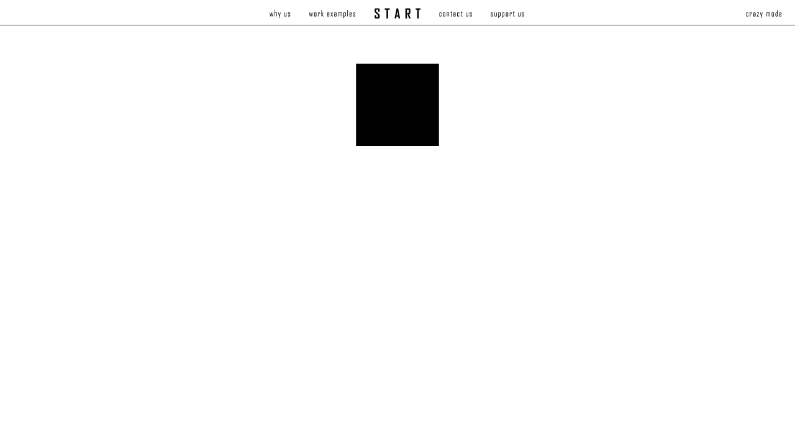

### Text Layers
- Node `107` (`START`): `START`
- Node `110` (`support us`): `support us`
- Node `111` (`work examples`): `work examples`
- Node `133` (`why us`): `why us`
- Node `135` (`contact us`): `contact us`
- Node `137` (`crazy mode`): `crazy mode`

### Embedded Images
- *(none)*

### Comments (5)

#### Comment #1 [OPEN]
- **Author:** `You` | **Created:** `2026-11-20T15:15:22Z`
- **Anchor:** `2` | **Position:** `(949.04, 251.89)` (`frame-relative`, matched via `anchor`)

> box appears from top of the screen

#### Comment #20 [OPEN]
- **Author:** `You` | **Created:** `2026-11-21T06:24:13Z`
- **Anchor:** `2` | **Position:** `(1856.06, 21.62)` (`frame-relative`, matched via `anchor`)

> turns everything non ascii into ascii

**Replies (2):**
- Reply 1 (`You` at `2026-11-21T06:24:33Z`):
  > and everything ascii become unascii
- Reply 2 (`You` at `2026-11-21T06:25:08Z`):
  > the white become black and the black become white and the red become blue

#### Comment #21 [OPEN]
- **Author:** `You` | **Created:** `2026-11-21T06:25:35Z`
- **Anchor:** `2` | **Position:** `(1044.58, 41.24)` (`frame-relative`, matched via `anchor`)

> navbar sticks all the way untill footer

**Replies (1):**
- Reply 1 (`You` at `2026-11-21T06:25:58Z`):
  > if the bg of the navbar is black turn the navbar white viseversa

#### Comment #23 [OPEN]
- **Author:** `You` | **Created:** `2026-11-21T06:37:18Z`
- **Anchor:** `2` | **Position:** `(945.18, 26.76)` (`frame-relative`, matched via `anchor`)

> when users hover on start the color that is "start"currently on gets inverted but not before a box the current color of start shows up behind start

#### Comment #24 [OPEN]
- **Author:** `You` | **Created:** `2026-11-21T06:38:07Z`
- **Anchor:** `2` | **Position:** `(1016.42, 27.90)` (`frame-relative`, matched via `anchor`)

> when users hover anything in navbar exept start that text morpsh into the typography of start
> the boldness font size everything

---

## Frame 02 (ID `6` — `Frame 1`)

- **Canvas position:** `x=336.0`, `y=1461.0` | **Dimensions:** `1920x1080`

### Text Layers
- *(none)*

### Embedded Images
- *(none)*

### Comments (0)

*(No comments mapped to this frame)*

---

## Frame 03 (ID `8` — `Frame 1`)

- **Canvas position:** `x=336.0`, `y=2541.0` | **Dimensions:** `1920x1080`

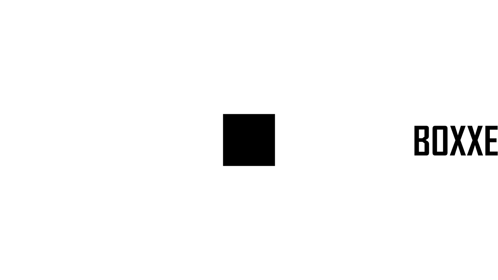

### Text Layers
- Node `10` (`BOXXES`): `BOXXES`

### Embedded Images
- *(none)*

### Comments (1)

#### Comment #2 [OPEN]
- **Author:** `You` | **Created:** `2026-11-20T15:20:16Z`
- **Anchor:** `8` | **Position:** `(1639.80, 460.76)` (`frame-relative`, matched via `anchor`)

> text appears from side of screen

---

## Frame 04 (ID `11` — `Frame 1`)

- **Canvas position:** `x=336.0`, `y=3621.0` | **Dimensions:** `1920x1080`

### Text Layers
- Node `13` (`BOXXES`): `BOXXES`

### Embedded Images
- *(none)*

### Comments (1)

#### Comment #3 [OPEN]
- **Author:** `You` | **Created:** `2026-11-20T15:20:27Z`
- **Anchor:** `11` | **Position:** `(1656.02, 503.24)` (`frame-relative`, matched via `anchor`)

> slides next to box

---

## Frame 05 (ID `15` — `Frame 1`)

- **Canvas position:** `x=336.0`, `y=4701.0` | **Dimensions:** `1920x1080`

### Text Layers
- Node `18` (`BOXXES`): `BOXXES`

### Embedded Images
- *(none)*

### Comments (1)

#### Comment #4 [OPEN]
- **Author:** `You` | **Created:** `2026-11-20T15:21:24Z`
- **Anchor:** `15` | **Position:** `(1159.66, 464.62)` (`frame-relative`, matched via `anchor`)

> both text and box becomes centered

**Replies (1):**
- Reply 1 (`You` at `2026-11-20T15:26:11Z`):
  > slides to become centered

---

## Frame 06 (ID `19` — `Frame 1`)

- **Canvas position:** `x=336.0`, `y=5781.0` | **Dimensions:** `1920x1080`

### Text Layers
- *(none)*

### Embedded Images
- *(none)*

### Comments (1)

#### Comment #5 [OPEN]
- **Author:** `You` | **Created:** `2026-11-20T15:22:19Z`
- **Anchor:** `19` | **Position:** `(1818.23, 448.70)` (`frame-relative`, matched via `anchor`)

> square grows and consumes text

---

## Frame 07 (ID `25` — `Frame 1`)

- **Canvas position:** `x=336.0`, `y=6862.0` | **Dimensions:** `1920x1080`

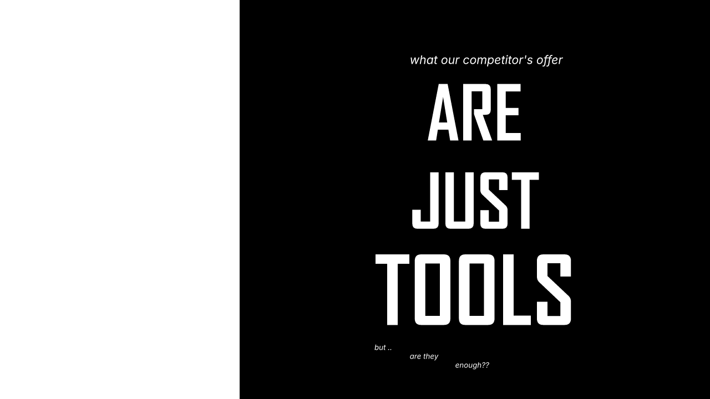

### Text Layers
- Node `28` (`ARE`): `ARE / JUST`
- Node `29` (`TOOLS`): `TOOLS`
- Node `30` (`but ..`): `but ..`
- Node `31` (`are they`): `are they`
- Node `32` (`enough??`): `enough??`
- Node `33` (`what our competitor's offer`): `what our competitor's offer`

### Embedded Images
- *(none)*

### Comments (2)

#### Comment #6 [OPEN]
- **Author:** `You` | **Created:** `2026-11-20T15:25:11Z`
- **Anchor:** `25` | **Position:** `(1279.70, 473.96)` (`frame-relative`, matched via `anchor`)

> text flips in out of nowhere

#### Comment #7 [OPEN]
- **Author:** `You` | **Created:** `2026-11-20T15:25:33Z`
- **Anchor:** `25` | **Position:** `(1386.75, 804.86)` (`frame-relative`, matched via `anchor`)

> "tools" constantly changing fonts

**Replies (1):**
- Reply 1 (`You` at `2026-11-20T15:38:53Z`):
  > make sure the text stays centered where it is

---

## Frame 08 (ID `34` — `Frame 1`)

- **Canvas position:** `x=336.0`, `y=7943.0` | **Dimensions:** `1920x1080`

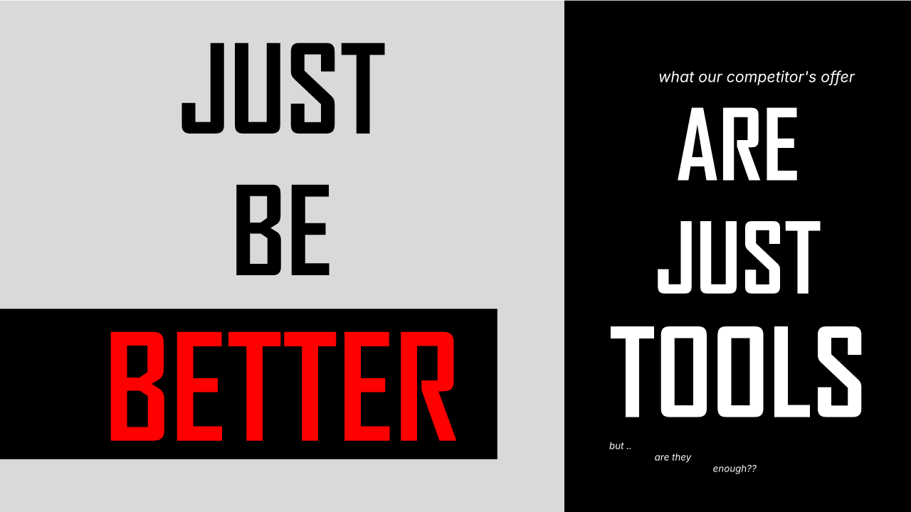

### Text Layers
- Node `37` (`ARE`): `ARE / JUST`
- Node `38` (`TOOLS`): `TOOLS`
- Node `39` (`but ..`): `but ..`
- Node `40` (`are they`): `are they`
- Node `41` (`enough??`): `enough??`
- Node `42` (`what our competitor's offer`): `what our competitor's offer`
- Node `43` (`JUST`): `JUST / BE`
- Node `46` (`BETTER`): `BETTER`

### Embedded Images
- *(none)*

### Comments (5)

#### Comment #8 [OPEN]
- **Author:** `You` | **Created:** `2026-11-20T15:34:46Z`
- **Anchor:** `34` | **Position:** `(1458.76, 848.18)` (`frame-relative`, matched via `anchor`)

> "tools" stop flickering

**Replies (1):**
- Reply 1 (`You` at `2026-11-21T02:07:29Z`):
  > also fades to white

#### Comment #9 [OPEN]
- **Author:** `You` | **Created:** `2026-11-20T15:37:27Z`
- **Anchor:** `34` | **Position:** `(647.71, 527.06)` (`frame-relative`, matched via `anchor`)

> text appear out of nowhere

**Replies (1):**
- Reply 1 (`You` at `2026-11-20T15:37:53Z`):
  > match with the previous text appearing animation

#### Comment #10 [OPEN]
- **Author:** `You` | **Created:** `2026-11-20T15:38:22Z` | **Edited:** `2026-11-21T02:13:03Z`
- **Anchor:** `34` | **Position:** `(623.62, 828.24)` (`frame-relative`, matched via `anchor`)

> "better"flickers just like "tools" did
> but this time the flicker itself is flickering
> 1 second its flickering next second its not flickering and stays on that font then it flickers again
> repeat this loop and use a arandom number generator to decide flicker time between 
> 0.2 sec and 0,8 sec

**Replies (1):**
- Reply 1 (`You` at `2026-11-21T01:19:39Z` (edited `2026-11-21T02:09:51Z`)):
  > "better" originally black now becomes red when black square covers

#### Comment #12 [OPEN]
- **Author:** `You` | **Created:** `2026-11-20T16:30:02Z`
- **Anchor:** `34` | **Position:** `(140.41, 785.04)` (`frame-relative`, matched via `anchor`)

> black rectangle comes from the sides

#### Comment #16 [OPEN]
- **Author:** `You` | **Created:** `2026-11-21T02:18:49Z`
- **Anchor:** `34` | **Position:** `(213.62, 212.66)` (`frame-relative`, matched via `anchor`)
- **Bundled Repository Asset:** [`assets/boxxes-ad.mp4`](assets/boxxes-ad.mp4) (copied into this repo because the local Windows path in the comment is not reachable from GitHub/AI Studio)

> replace bg placeholder with c:\Users\AFADAZIO\Obsidian\Awwwards-Vault\Examples\boxxes-video\boxxes-ad.mp4

---

## Frame 09 (ID `62` — `Frame 1`)

- **Canvas position:** `x=336.0`, `y=9024.0` | **Dimensions:** `1920x1080`

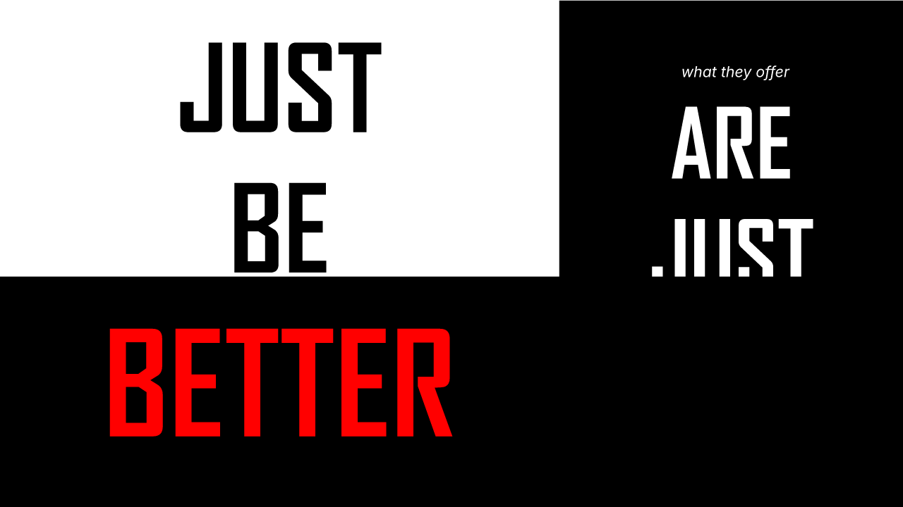

### Text Layers
- Node `65` (`ARE`): `ARE / JUST`
- Node `66` (`TOOLS`): `TOOLS`
- Node `67` (`but ..`): `but ..`
- Node `68` (`are they`): `are they`
- Node `69` (`enough??`): `enough??`
- Node `70` (`what they offer`): `what they offer`
- Node `71` (`JUST`): `JUST / BE`
- Node `73` (`BETTER`): `BETTER`

### Embedded Images
- *(none)*

### Comments (3)

#### Comment #11 [OPEN]
- **Author:** `You` | **Created:** `2026-11-20T15:39:39Z`
- **Anchor:** `null` | **Position:** `(1359.18, 9273.84)` (`canvas-absolute`, matched via `bounds`)

> stick this until next page fully arrives

#### Comment #13 [OPEN]
- **Author:** `You` | **Created:** `2026-11-20T16:30:58Z` | **Edited:** `2026-11-21T02:13:46Z`
- **Anchor:** `62` | **Position:** `(1202.63, 816.40)` (`frame-relative`, matched via `anchor`)

> next page arriving from below

#### Comment #14 [OPEN]
- **Author:** `You` | **Created:** `2026-11-21T01:40:23Z`
- **Anchor:** `62` | **Position:** `(636.24, 826.94)` (`frame-relative`, matched via `anchor`)

> "better still sticks

---

## Frame 10 (ID `91` — `Frame 1`)

- **Canvas position:** `x=336.0`, `y=10104.0` | **Dimensions:** `1920x1080`

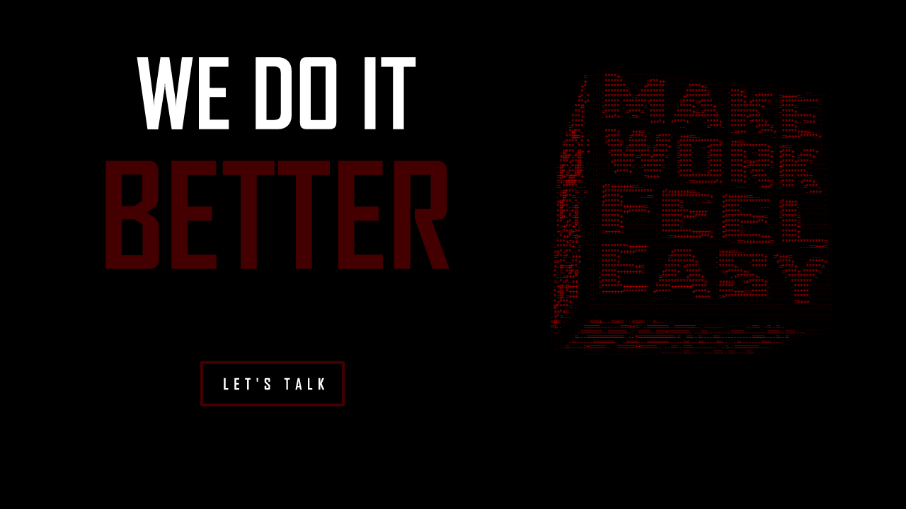

### Text Layers
- Node `103` (`BETTER`): `BETTER`
- Node `104` (`WE DO IT`): `WE DO IT`
- Node `138` (`LET'S TALK`): `LET'S TALK`

### Embedded Images
- Node `121` (`Pasted image`): [`unpacked/images/ef0d4b442c7701fb623e8e35fb20c79e218c8be71a71aa9b90d4c7ce7ec1ec8c.png`](unpacked/images/ef0d4b442c7701fb623e8e35fb20c79e218c8be71a71aa9b90d4c7ce7ec1ec8c.png) (582x510)

### Comments (4)

#### Comment #15 [OPEN]
- **Author:** `You` | **Created:** `2026-11-21T02:14:10Z`
- **Anchor:** `91` | **Position:** `(596.54, 454.36)` (`frame-relative`, matched via `anchor`)

> "better"goes up still flickering

**Replies (1):**
- Reply 1 (`You` at `2026-11-21T06:13:15Z`):
  > hue of red changes

#### Comment #17 [OPEN]
- **Author:** `You` | **Created:** `2026-11-21T06:11:49Z`
- **Anchor:** `91` | **Position:** `(1445.30, 336.67)` (`frame-relative`, matched via `anchor`)

> change this to the rel index.html file currently this just placeholder also put the default posisition like this
> https://github.com/envexnity/editable-ascii-box-asset
> text shou7ld be
> MAKE
> WORK
> FEEL
> EASY

#### Comment #18 [OPEN]
- **Author:** `You` | **Created:** `2026-11-21T06:14:03Z`
- **Anchor:** `91` | **Position:** `(1534.88, 486.32)` (`frame-relative`, matched via `anchor`)

> make this ineractale

#### Comment #19 [OPEN]
- **Author:** `You` | **Created:** `2026-11-21T06:19:39Z`
- **Anchor:** `91` | **Position:** `(1311.03, 625.46)` (`frame-relative`, matched via `anchor`)

> when user hovers overcube it a red box with "drag written on it should appear

---

## Frame 11 (ID `145` — `Frame 1`)

- **Canvas position:** `x=2256.0`, `y=10104.0` | **Dimensions:** `1920x1080`

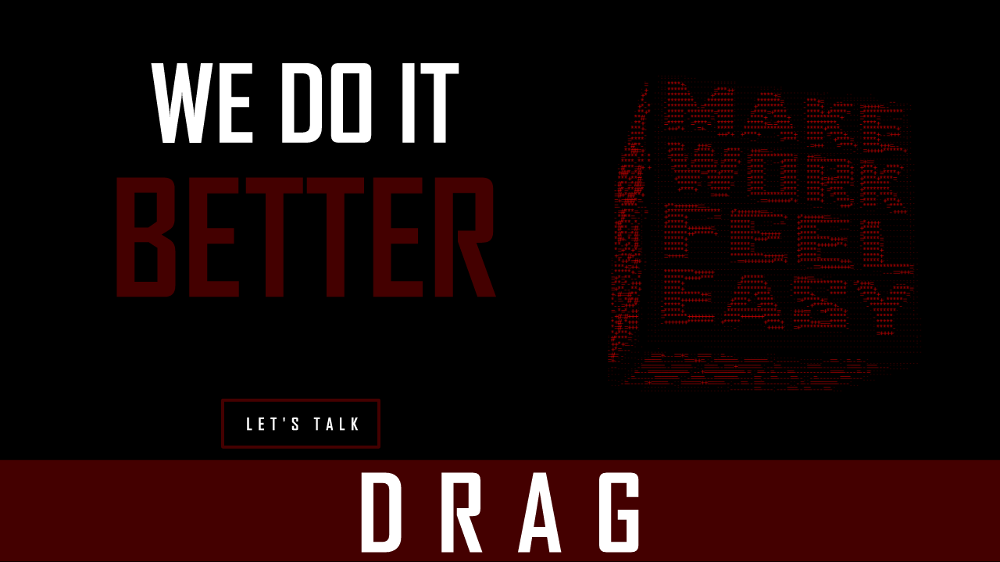

### Text Layers
- Node `147` (`BETTER`): `BETTER`
- Node `148` (`WE DO IT`): `WE DO IT`
- Node `151` (`LET'S TALK`): `LET'S TALK`
- Node `136` (`DRAG`): `DRAG`

### Embedded Images
- Node `149` (`Pasted image`): [`unpacked/images/ef0d4b442c7701fb623e8e35fb20c79e218c8be71a71aa9b90d4c7ce7ec1ec8c.png`](unpacked/images/ef0d4b442c7701fb623e8e35fb20c79e218c8be71a71aa9b90d4c7ce7ec1ec8c.png) (582x510)

### Comments (0)

*(No comments mapped to this frame)*

---

## Frame 12 (ID `122` — `Frame 1`)

- **Canvas position:** `x=336.0`, `y=11184.0` | **Dimensions:** `1920x1080`

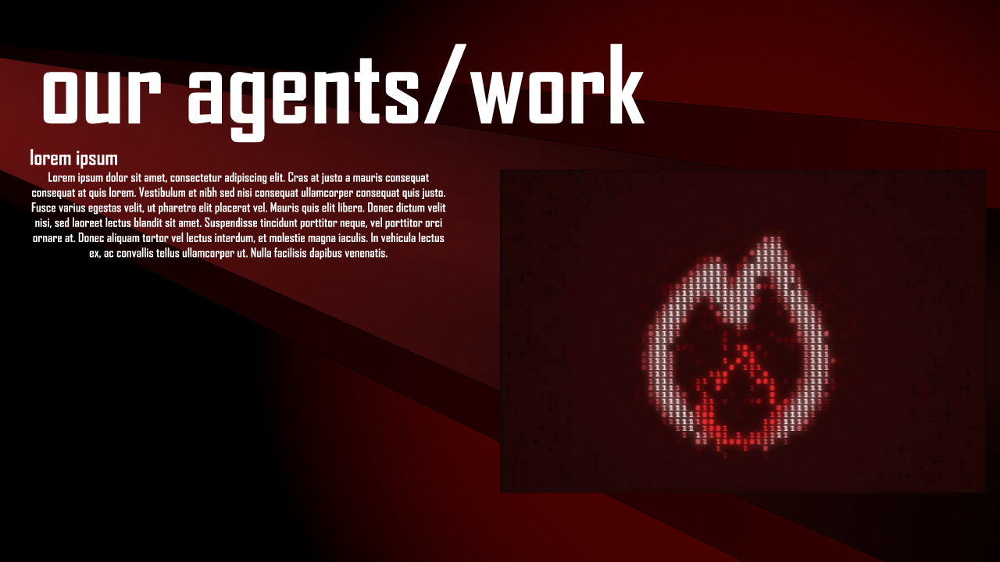

### Text Layers
- Node `153` (`our agents/work`): `our agents/work`
- Node `154` (`lorem ipsum`): `lorem ipsum`
- Node `155` (`Lorem ipsum dolor sit amet, consectetur adipiscing elit. Cras at`): `Lorem ipsum dolor sit amet, consectetur adipiscing elit. Cras at justo a mauris consequat consequat at quis lorem. Vestibulum et nibh sed nisi consequat ullamcorper consequat quis justo. Fusce varius egestas velit, ut pharetra elit placerat vel. Mauris quis elit libero. Donec dictum velit nisi, sed laoreet lectus blandit sit amet. Suspendisse tincidunt porttitor neque, vel porttitor orci ornare at. Donec aliquam tortor vel lectus interdum, et molestie magna iaculis. In vehicula lectus ex, ac convallis tellus ullamcorper ut. Nulla facilisis dapibus venenatis. /  / `

### Embedded Images
- Node `157` (`Pasted image`): [`unpacked/images/b225ae22f80202f7286c3ed4c62e46fa47b550965eb18360d5aed2e7a62840ac.png`](unpacked/images/b225ae22f80202f7286c3ed4c62e46fa47b550965eb18360d5aed2e7a62840ac.png) (933x622)

### Comments (5)

#### Comment #22 [OPEN]
- **Author:** `You` | **Created:** `2026-11-21T06:32:15Z`
- **Anchor:** `122` | **Position:** `(728.11, 142.53)` (`frame-relative`, matched via `anchor`)

> this sticks until the entire section isfinised

#### Comment #25 [OPEN]
- **Author:** `You` | **Created:** `2026-11-21T06:41:56Z`
- **Anchor:** `122` | **Position:** `(1524.42, 511.26)` (`frame-relative`, matched via `anchor`)

> this is a placeholder replace with
> https://21st.dev/community/ascii/hanzo-fire-alarm-code-025c90a5-8f5c-4e0b-88e6-3484b122a641

#### Comment #30 [OPEN]
- **Author:** `You` | **Created:** `2026-11-21T06:47:26Z`
- **Anchor:** `122` | **Position:** `(1518.87, 162.87)` (`frame-relative`, matched via `anchor`)

> optimize this whole section so it runs smoothly

#### Comment #31 [OPEN]
- **Author:** `You` | **Created:** `2026-11-21T07:49:16Z`
- **Anchor:** `122` | **Position:** `(1154.23, 435.87)` (`frame-relative`, matched via `anchor`)

> on every single picture blur out the edges of the red and black so it transitions smoothly

#### Comment #32 [OPEN]
- **Author:** `You` | **Created:** `2026-11-21T08:11:12Z`
- **Anchor:** `122` | **Position:** `(873.38, 541.62)` (`frame-relative`, matched via `anchor`)

> animate the background  and put it on everypart on this setion

**Replies (1):**
- Reply 1 (`You` at `2026-11-21T08:12:06Z`):
  > this should happen afterthe section is fully loaded

---

## Frame 13 (ID `221` — `Frame 1`)

- **Canvas position:** `x=336.0`, `y=12264.0` | **Dimensions:** `1920x1080`

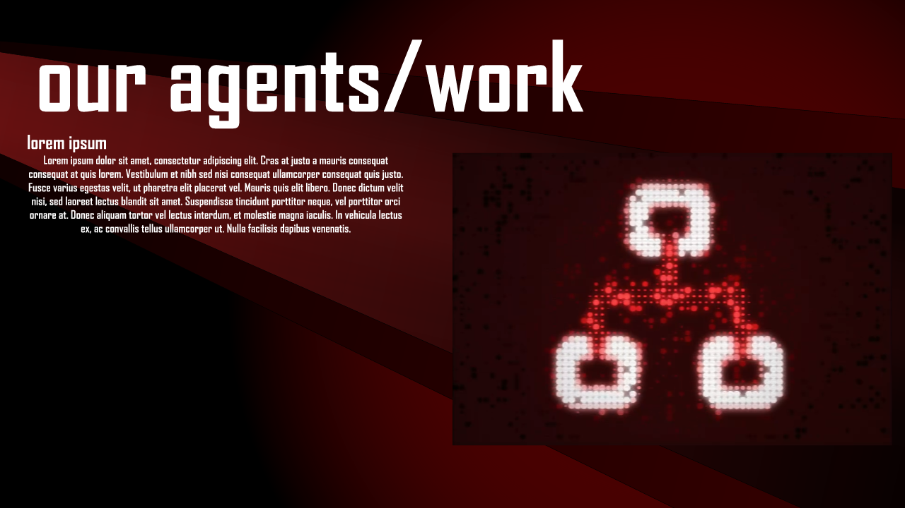

### Text Layers
- Node `226` (`our agents/work`): `our agents/work`
- Node `227` (`lorem ipsum`): `lorem ipsum`
- Node `228` (`Lorem ipsum dolor sit amet, consectetur adipiscing elit. Cras at`): `Lorem ipsum dolor sit amet, consectetur adipiscing elit. Cras at justo a mauris consequat consequat at quis lorem. Vestibulum et nibh sed nisi consequat ullamcorper consequat quis justo. Fusce varius egestas velit, ut pharetra elit placerat vel. Mauris quis elit libero. Donec dictum velit nisi, sed laoreet lectus blandit sit amet. Suspendisse tincidunt porttitor neque, vel porttitor orci ornare at. Donec aliquam tortor vel lectus interdum, et molestie magna iaculis. In vehicula lectus ex, ac convallis tellus ullamcorper ut. Nulla facilisis dapibus venenatis. /  / `

### Embedded Images
- Node `166` (`Pasted image`): [`unpacked/images/e5cf68c78a60c6c40b701f7caae8f261c62d132f393bf2099a37eddb6ff4c6ad.png`](unpacked/images/e5cf68c78a60c6c40b701f7caae8f261c62d132f393bf2099a37eddb6ff4c6ad.png) (933x622)

### Comments (1)

#### Comment #26 [OPEN]
- **Author:** `You` | **Created:** `2026-11-21T06:43:13Z`
- **Anchor:** `null` | **Position:** `(1711.59, 12893.47)` (`canvas-absolute`, matched via `bounds`)

> this is a placeholder replace with
> https://21st.dev/community/ascii/hanzo-network-led-dots-44b695f5-8859-4398-9f6f-da182c28a895

---

## Frame 14 (ID `231` — `Frame 1`)

- **Canvas position:** `x=336.0`, `y=13344.0` | **Dimensions:** `1920x1080`

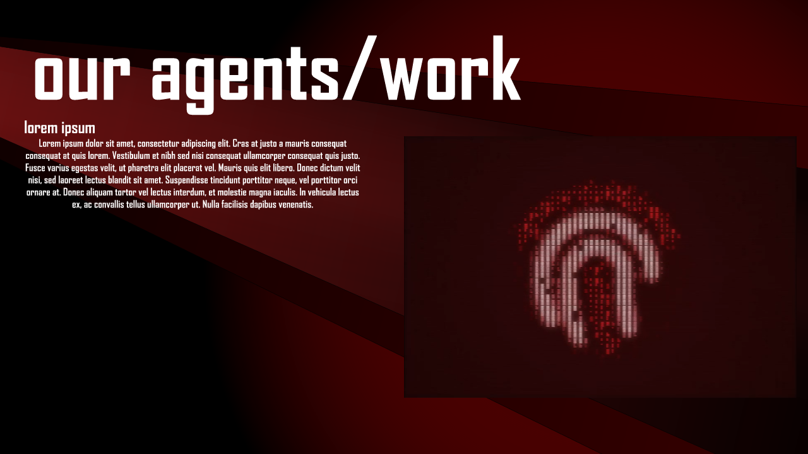

### Text Layers
- Node `236` (`our agents/work`): `our agents/work`
- Node `237` (`lorem ipsum`): `lorem ipsum`
- Node `238` (`Lorem ipsum dolor sit amet, consectetur adipiscing elit. Cras at`): `Lorem ipsum dolor sit amet, consectetur adipiscing elit. Cras at justo a mauris consequat consequat at quis lorem. Vestibulum et nibh sed nisi consequat ullamcorper consequat quis justo. Fusce varius egestas velit, ut pharetra elit placerat vel. Mauris quis elit libero. Donec dictum velit nisi, sed laoreet lectus blandit sit amet. Suspendisse tincidunt porttitor neque, vel porttitor orci ornare at. Donec aliquam tortor vel lectus interdum, et molestie magna iaculis. In vehicula lectus ex, ac convallis tellus ullamcorper ut. Nulla facilisis dapibus venenatis. /  / `

### Embedded Images
- Node `173` (`Pasted image`): [`unpacked/images/eeb85ec773281368fc6e88aedcbfabd732fbf9c1a37d1d54d5dc967341bda7d3.png`](unpacked/images/eeb85ec773281368fc6e88aedcbfabd732fbf9c1a37d1d54d5dc967341bda7d3.png) (933x622)

### Comments (1)

#### Comment #27 [OPEN]
- **Author:** `You` | **Created:** `2026-11-21T06:44:02Z`
- **Anchor:** `null` | **Position:** `(1605.06, 13911.07)` (`canvas-absolute`, matched via `bounds`)

> this is a placeholder replace with
> https://21st.dev/community/ascii/hanzo-biometric-braille-4b609494-71b6-424d-a7b7-a4e913467945

---

## Frame 15 (ID `241` — `Frame 1`)

- **Canvas position:** `x=336.0`, `y=14424.0` | **Dimensions:** `1920x1080`

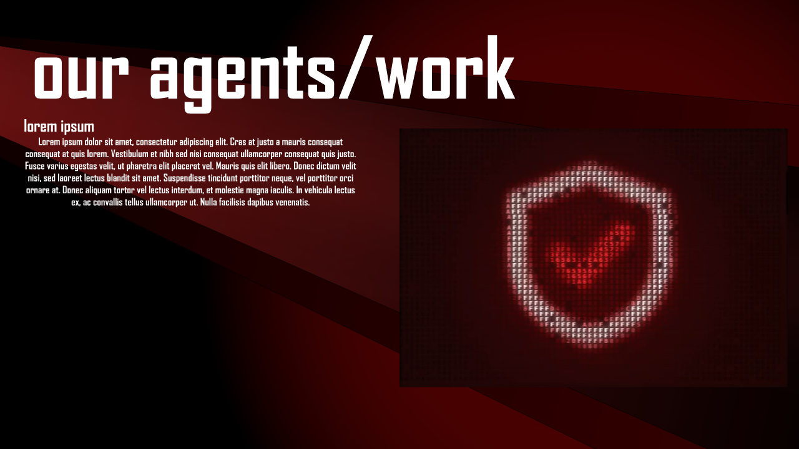

### Text Layers
- Node `246` (`our agents/work`): `our agents/work`
- Node `247` (`lorem ipsum`): `lorem ipsum`
- Node `248` (`Lorem ipsum dolor sit amet, consectetur adipiscing elit. Cras at`): `Lorem ipsum dolor sit amet, consectetur adipiscing elit. Cras at justo a mauris consequat consequat at quis lorem. Vestibulum et nibh sed nisi consequat ullamcorper consequat quis justo. Fusce varius egestas velit, ut pharetra elit placerat vel. Mauris quis elit libero. Donec dictum velit nisi, sed laoreet lectus blandit sit amet. Suspendisse tincidunt porttitor neque, vel porttitor orci ornare at. Donec aliquam tortor vel lectus interdum, et molestie magna iaculis. In vehicula lectus ex, ac convallis tellus ullamcorper ut. Nulla facilisis dapibus venenatis. /  / `

### Embedded Images
- Node `180` (`Pasted image`): [`unpacked/images/a5a96cabe968622452e9545acf59f45950cbe88f3a3d9dac243ad69712ef0aba.png`](unpacked/images/a5a96cabe968622452e9545acf59f45950cbe88f3a3d9dac243ad69712ef0aba.png) (933x622)

### Comments (1)

#### Comment #28 [OPEN]
- **Author:** `You` | **Created:** `2026-11-21T06:45:32Z`
- **Anchor:** `null` | **Position:** `(1726.29, 15116.02)` (`canvas-absolute`, matched via `bounds`)

> this is a placeholder replace with
> https://21st.dev/community/ascii/hanzo-secure-shield-hex-97438cfd-a0b5-4bf6-bf9d-43a752e80ac3

---

## Frame 16 (ID `251` — `Frame 1`)

- **Canvas position:** `x=336.0`, `y=15504.0` | **Dimensions:** `1920x1080`

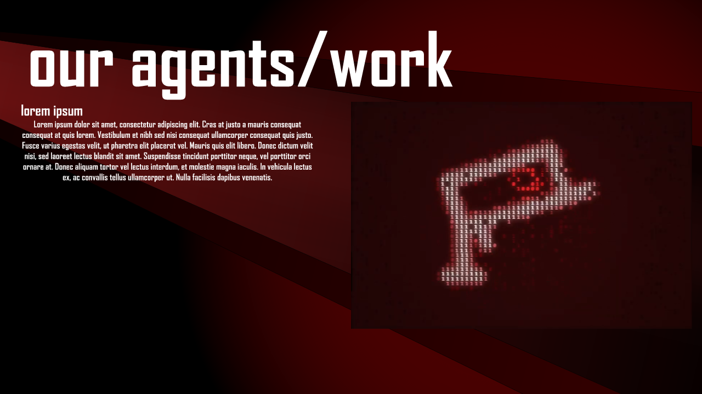

### Text Layers
- Node `256` (`our agents/work`): `our agents/work`
- Node `257` (`lorem ipsum`): `lorem ipsum`
- Node `258` (`Lorem ipsum dolor sit amet, consectetur adipiscing elit. Cras at`): `Lorem ipsum dolor sit amet, consectetur adipiscing elit. Cras at justo a mauris consequat consequat at quis lorem. Vestibulum et nibh sed nisi consequat ullamcorper consequat quis justo. Fusce varius egestas velit, ut pharetra elit placerat vel. Mauris quis elit libero. Donec dictum velit nisi, sed laoreet lectus blandit sit amet. Suspendisse tincidunt porttitor neque, vel porttitor orci ornare at. Donec aliquam tortor vel lectus interdum, et molestie magna iaculis. In vehicula lectus ex, ac convallis tellus ullamcorper ut. Nulla facilisis dapibus venenatis. /  / `

### Embedded Images
- Node `189` (`Pasted image`): [`unpacked/images/ea97997f3a434e66f6b4611cc63f15f2372ee0331a27252a078c24e59f51c882.png`](unpacked/images/ea97997f3a434e66f6b4611cc63f15f2372ee0331a27252a078c24e59f51c882.png) (933x622)

### Comments (1)

#### Comment #29 [OPEN]
- **Author:** `You` | **Created:** `2026-11-21T06:46:43Z`
- **Anchor:** `null` | **Position:** `(1737.31, 16093.21)` (`canvas-absolute`, matched via `bounds`)

> this is a placeholder replace with
> https://21st.dev/community/ascii/hanzo-cctv-binary-9ec4a5d6-2869-44d7-8484-ab209c6433bd

---

## Frame 17 (ID `208` — `Frame 1`)

- **Canvas position:** `x=336.0`, `y=16584.0` | **Dimensions:** `1920x1080`

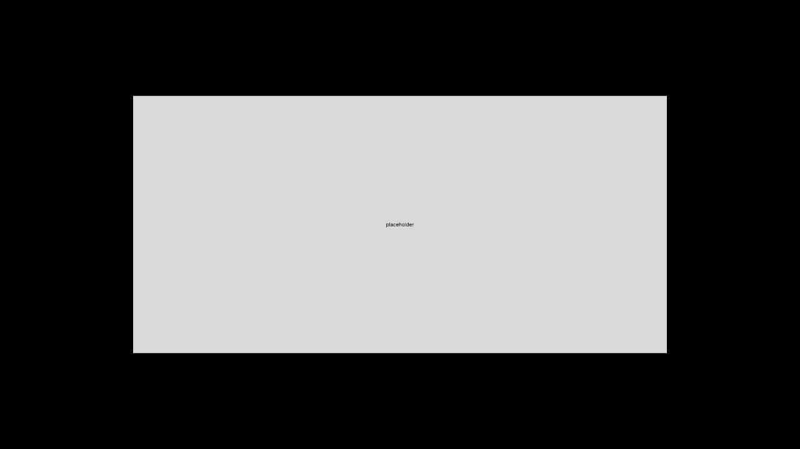

### Text Layers
- Node `219` (`placeholder`): `placeholder`

### Embedded Images
- *(none)*

### Comments (2)

#### Comment #33 [OPEN]
- **Author:** `You` | **Created:** `2026-11-21T08:49:23Z`
- **Anchor:** `208` | **Position:** `(1313.80, 562.16)` (`frame-relative`, matched via `anchor`)

> put a pricing section here with the asset combination of
> https://21st.dev/@jahed/components/spotlight-card
> and
> https://21st.dev/@minhxthanh/components/gradient-card-showcase

**Replies (2):**
- Reply 1 (`You` at `2026-11-21T08:49:38Z`):
  > and remove the placeholder
- Reply 2 (`You` at `2026-11-21T08:52:21Z`):
  > also adjust the color choices

#### Comment #34 [RESOLVED]
- **Author:** `You` | **Created:** `2026-11-21T08:54:06Z`
- **Anchor:** `null` | **Position:** `(3073.70, 16898.71)` (`canvas-absolute`, matched via `nearest`)

> bg rays rotate out the way and bg blur follows

---

## External Component & Asset Links

| Comment | Frame | Resource / URL | Repository Status |
|---:|---|---|---|
| #17 | Frame 10 (`91`) | https://github.com/envexnity/editable-ascii-box-asset | External reference |
| #25 | Frame 12 (`122`) | https://21st.dev/community/ascii/hanzo-fire-alarm-code-025c90a5-8f5c-4e0b-88e6-3484b122a641 | External reference |
| #26 | Frame 13 (`221`) | https://21st.dev/community/ascii/hanzo-network-led-dots-44b695f5-8859-4398-9f6f-da182c28a895 | External reference |
| #27 | Frame 14 (`231`) | https://21st.dev/community/ascii/hanzo-biometric-braille-4b609494-71b6-424d-a7b7-a4e913467945 | External reference |
| #28 | Frame 15 (`241`) | https://21st.dev/community/ascii/hanzo-secure-shield-hex-97438cfd-a0b5-4bf6-bf9d-43a752e80ac3 | External reference |
| #29 | Frame 16 (`251`) | https://21st.dev/community/ascii/hanzo-cctv-binary-9ec4a5d6-2869-44d7-8484-ab209c6433bd | External reference |
| #33 | Frame 17 (`208`) | https://21st.dev/@jahed/components/spotlight-card | External reference |
| #33 | Frame 17 (`208`) | https://21st.dev/@minhxthanh/components/gradient-card-showcase | External reference |
| #16 | Frame 08 (`34`) | `c:\Users\AFADAZIO\Obsidian\Awwwards-Vault\Examples\boxxes-video\boxxes-ad.mp4` | Bundled at [`assets/boxxes-ad.mp4`](assets/boxxes-ad.mp4) |
